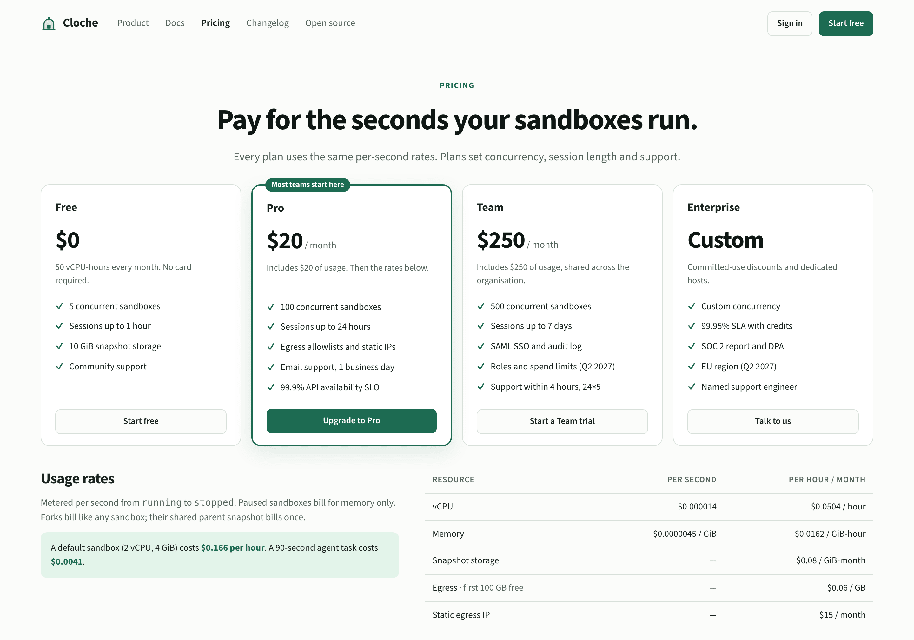

## Proposed plans

| | Free | Pro | Team | Enterprise |
| --- | --- | --- | --- | --- |
| Platform fee | $0 | $20 / month | $250 / month | Custom |
| Included usage | 50 vCPU-hours | $20 | $250 | Committed use |
| Concurrent sandboxes | 5 | 100 | 500 | Custom |
| Max session | 1 h | 24 h | 7 days | Custom |
| Snapshot storage included | 10 GiB | Billed | Billed | Billed |
| Egress allowlists, static IPs | Allowlists only | Yes | Yes | Yes |
| SSO and audit log | No | No | Yes | Yes |
| Support | Community | Email, 1 business day | 4 h, 24x5 | Named engineer |
| Availability | Best effort | 99.9% SLO | 99.9% SLO | 99.95% SLA |

## Rates

| Resource | Rate | Per hour |
| --- | --- | --- |
| vCPU | $0.000014 per second | $0.0504 |
| Memory | $0.0000045 per GiB-second | $0.0162 per GiB |
| Snapshot storage | $0.08 per GiB-month | |
| Egress | First 100 GB per month free, then $0.06 per GB | |
| Static egress IP | $15 per month | |

A default sandbox (2 vCPU, 4 GiB) costs $0.166 per hour; a typical 90-second agent task costs $0.0041.

<Decision title="One set of rates for every plan">
  We considered discounting rates on Team. We chose identical rates and differentiated plans by limits and support, because beta customers consistently asked "what will this cost" and a single rate card answers it. Volume discounts are an Enterprise conversation.
</Decision>

<Risk title="Free-tier abuse">
  During the beta, 4% of free organisations ran crypto-mining or proxy workloads. The free tier keeps a 5-sandbox cap, requires a verified GitHub or Google account, and depends on [abuse detection](../../security/items/abuse-detection.md) being live at GA.
</Risk>

## Open questions

- Should Pro's $20 fee include $20 of usage, or a fixed 400 vCPU-hours? Dollars are simpler; hours are more generous-sounding. Current lean: dollars.
- Do we grandfather beta organisations for 3 months at no platform fee? Cost estimate: $41,000 of forgone fees.
