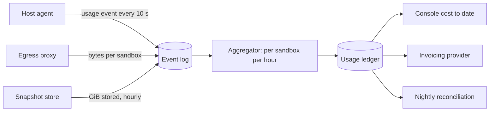

## Pipeline



Each host agent emits one event per running sandbox every 10 seconds. Events are idempotent by `(sandbox_id, seq)`, so a retried batch never double-bills.

```json title="usage event"
{
  "type": "sandbox.usage",
  "sandbox_id": "sbx_4k9m2x7q",
  "org_id": "org_7Hc2",
  "seq": 248,
  "window": { "start": "2026-11-24T16:42:00Z", "end": "2026-11-24T16:42:10Z" },
  "state": "running",
  "vcpu_seconds": 20.0,
  "gib_seconds": 40.0,
  "egress_bytes": 18234
}
```

A paused sandbox emits `gib_seconds` only, which is how "paused sandboxes bill for memory" is enforced.

## Reconciliation

Nightly, a separate job recomputes usage from lifecycle events (created, paused, resumed, stopped) and compares per organisation. A difference above 0.1% for any organisation pages the platform on-call and holds that organisation's invoice.

<Risk title="Clock skew between hosts">
  A sandbox that forks to a different host could be billed for an overlapping window. Windows are assigned by the control plane's clock at fork time, not the host's, and the reconciliation job flags overlaps.
</Risk>
