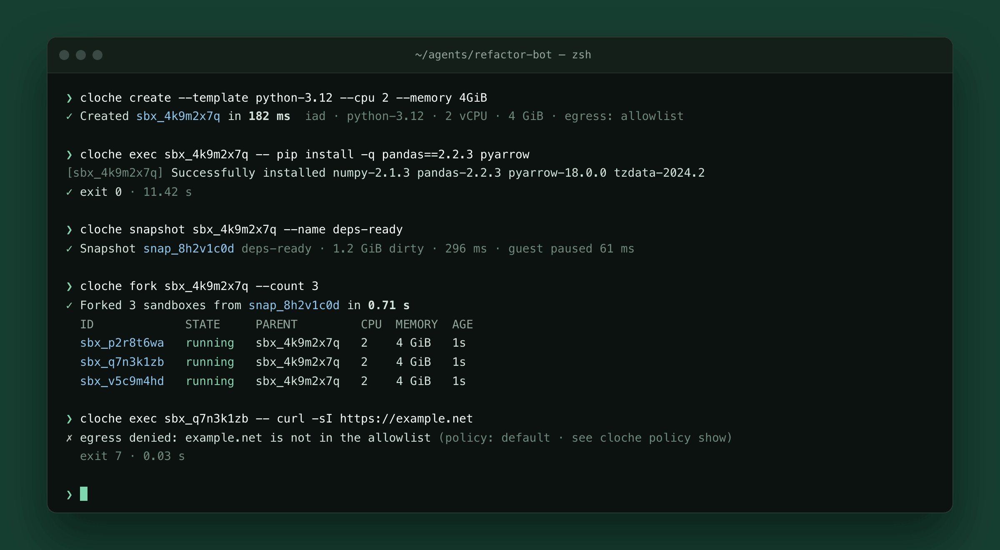

## The session we optimise for



The same flow, scripted:

```bash title="Terminal"
$ cloche login
Opening https://console.cloche.example/cli-auth?code=WQRT-8812 …
✓ Logged in as dana@acme-agents.example (org: acme-agents, plan: Pro)

$ cloche create --template node-22 --cpu 4 --memory 8GiB --timeout 20m --json | jq -r .id
sbx_h3d8w1ke

$ cloche exec sbx_h3d8w1ke --cwd /workspace -- npm test
> shop@2.4.0 test
> vitest run
 ✓ 212 tests passed (14.8 s)
$ echo $?
0

$ cloche ls --state running --json | jq length
37
```

## Commands at 1.0

| Command | Notes |
| --- | --- |
| `create`, `exec`, `shell`, `stop`, `rm` | `exec` streams output and returns the guest's exit code |
| `snapshot`, `fork`, `restore` | `fork --count` up to 16 |
| `ls`, `inspect`, `logs -f` | `--json` everywhere, schema `cloche.cli/v1` |
| `cp` | Copy files in and out, `cloche cp ./data sbx_…:/workspace` |
| `policy apply`, `policy show` | See [egress policy](../../runtime/items/egress-policy.mdx) |
| `login`, `whoami`, `keys` | Device-code login; `CLOCHE_API_KEY` wins when set |

## Project config

A `cloche.toml` in the repository sets defaults so that `cloche create` with no flags does the right thing:

```toml title="cloche.toml"
[sandbox]
template = "python-3.12"
cpu = 2
memory = "4GiB"
timeout = "30m"

[sandbox.env]
PIP_DISABLE_PIP_VERSION_CHECK = "1"

[network]
policy = "data-analyst"

[[volumes]]
name = "pip-cache"
mount = "/root/.cache/pip"
```

<Decision title="Exit code of exec">
  `cloche exec` returns the exit code of the command inside the sandbox, and reserves 125 to 127 for Cloche-side failures (125: Cloche error, 126: sandbox not running, 127: command not found). This matches what people expect from `docker run` and lets `set -e` scripts work unchanged.
</Decision>

## Acceptance criteria

- [x] `--json` on every read command, with a JSON Schema published per command.
- [x] Exit codes documented and covered by golden tests.
- [ ] `cloche.toml` discovery from the current directory up to the repository root.
- [ ] Windows x64 build passes the same golden tests.
- [ ] Shell completions for bash, zsh and fish.
