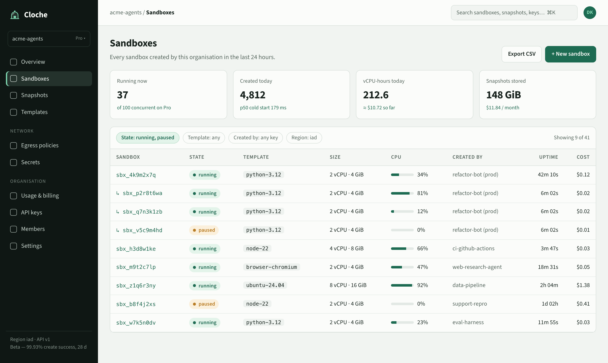

## Scope for GA

The console is a read-mostly tool. Agents create sandboxes through the API; people use the console to inspect them, stop runaway ones, manage keys and understand the bill. We are deliberately not building an in-browser IDE.

