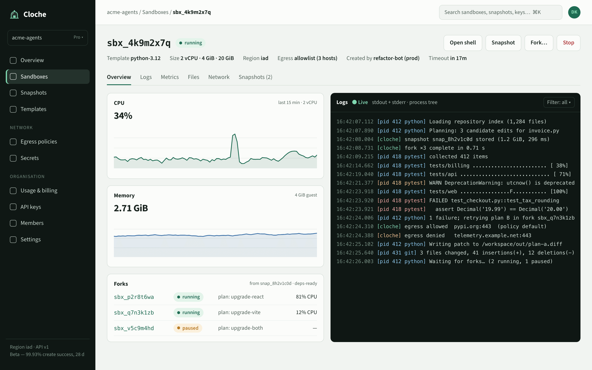
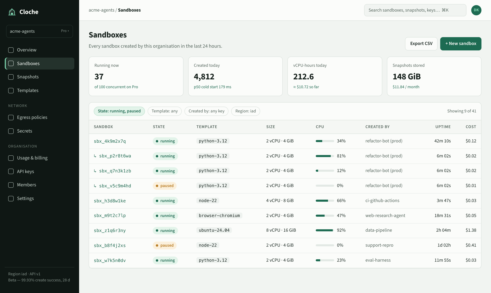

## Design

The page is laid out for the question "is it stuck, busy or broken?":

1. **Header:** state, template, size, egress mode, creator, and time until timeout. Actions: open shell, snapshot, fork, stop.
2. **CPU and memory:** last 15 minutes at 1 s resolution. A flat 0% CPU line for more than 2 minutes on a running sandbox shows a hint: "This sandbox looks idle. Stop it or pause it to save $0.17 per hour."
3. **Logs:** stdout and stderr of every process, tagged with PID and command, interleaved with Cloche's own lifecycle and egress events.
4. **Forks:** children and their state, with a link to each.

<Decision title="Logs are read-only">
  We will not add a terminal input to the log panel. "Open shell" is a separate, audited action because typing into a production agent's sandbox is something a security reviewer will ask about.
</Decision>

## Acceptance criteria

- [x] Log panel renders 2,000 lines per second without dropping frames on a 2020 laptop.
- [x] Egress decisions appear inline in the log stream.
- [ ] Charts backfill on page load from the metrics API, then stream.
- [ ] Forks section lists children with links.
- [ ] Page is usable at 1280 px width; logs collapse under the charts below 1100 px.
