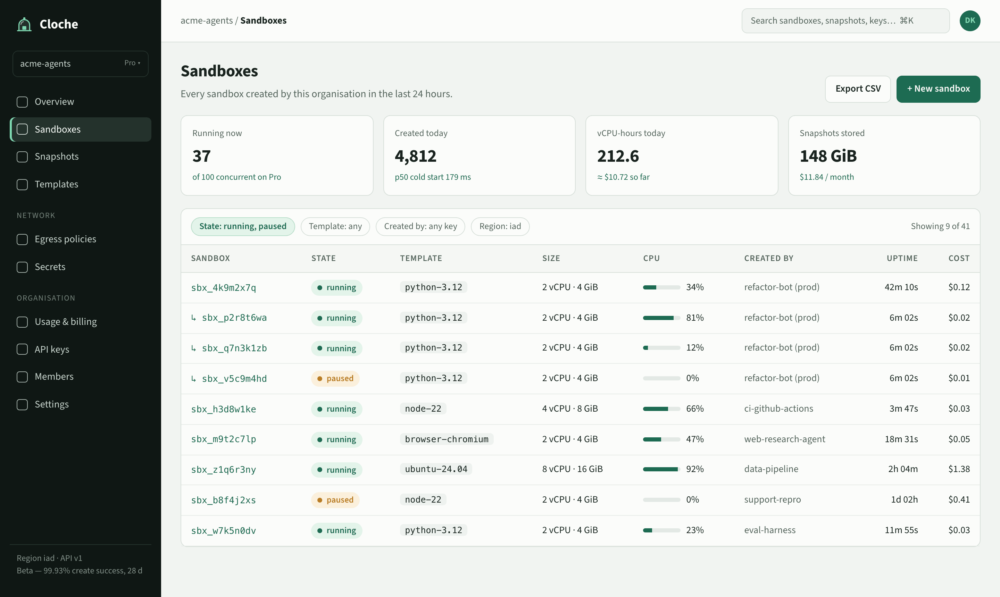

## What shipped

- Summary cards: running now against the plan's concurrency, created today with p50 cold start, vCPU-hours and spend today, snapshot storage.
- Filters for state, template, API key and region, kept in the URL.
- Forks are nested under their parent.
- Cost to date per sandbox, updated every 60 s from the [usage meter](../../billing/items/usage-metering.mdx).

## Usage since launch

58% of weekly active console users open this page at least once a week. The most used filter is "Created by" (API key), because most organisations use one key per agent.
