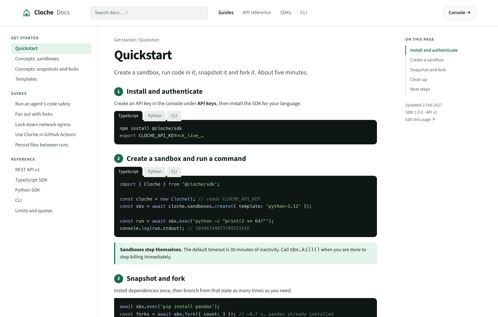

## Draft

## What changes from the beta quickstart

- **API key in one step.** The console's new-key dialog shows a ready-to-paste `export CLOCHE_API_KEY=…` line (CON-28). This removes the step where 31% of readers dropped off.
- **One concept per step.** Create and exec, then snapshot and fork. Egress and templates move to their own guides.
- **Every sample runs in CI** against the staging API with a fresh organisation, so the quickstart cannot rot.

## How we measure it

The docs page emits `quickstart_opened` with an anonymous ID; the API key creation and first `POST /v1/sandboxes` carry the same ID through the console handoff. We report the median and p75 weekly from 1 February.

<Outcome title="Beta baseline">
  Median 9 min 40 s, p75 22 min, completion 54% within a day. Target at GA: median under 5 min, completion above 70%.
</Outcome>
