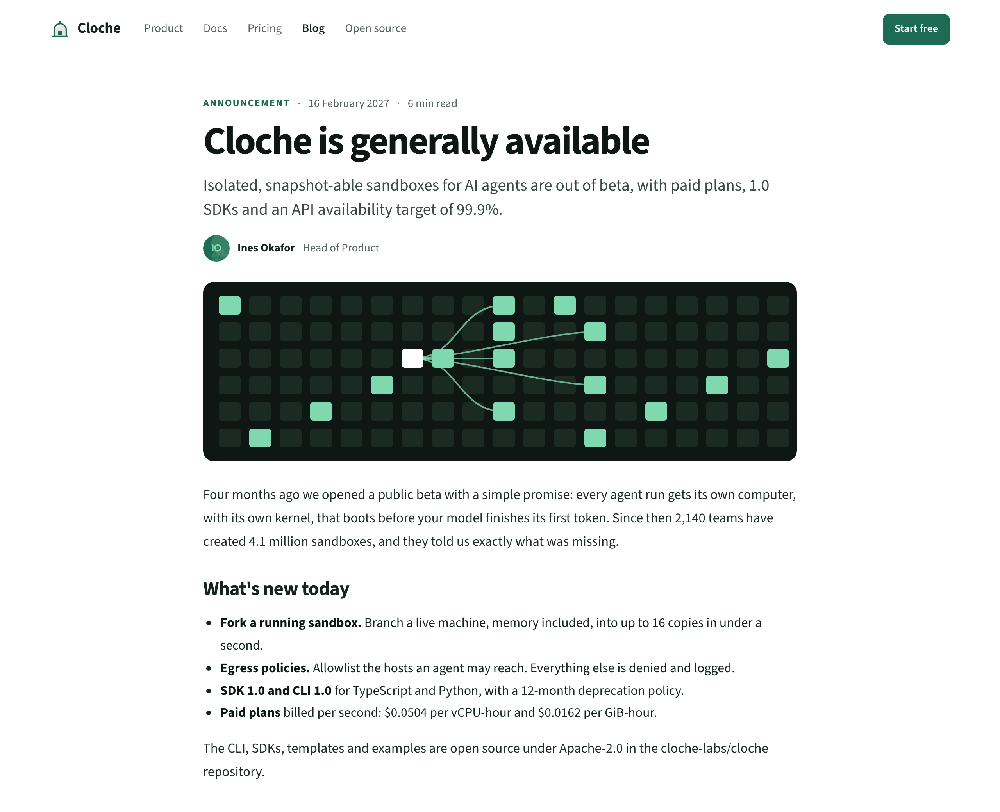

## Draft

## Structure

1. One paragraph: what Cloche is and what changes today.
2. What's new: fork, egress policies, 1.0 SDKs and CLI, paid plans.
3. Two customer quotes with numbers (approved: Nettlebyte, Kestrova).
4. Pricing summary and link.
5. Open source: the repository and how to contribute.
6. What's next: teams, EU region, OpenTelemetry. No dates beyond the quarter.

## Rules

- Every number in the post is in the [landing page claims table](../../website/items/landing-page.mdx) with its source.
- No comparison with named competitors.
- Final copy frozen on 12 February; changes after that need Ines and Elena.
