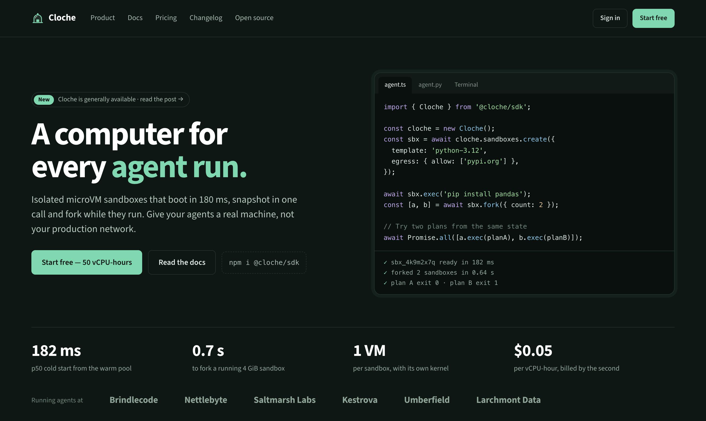
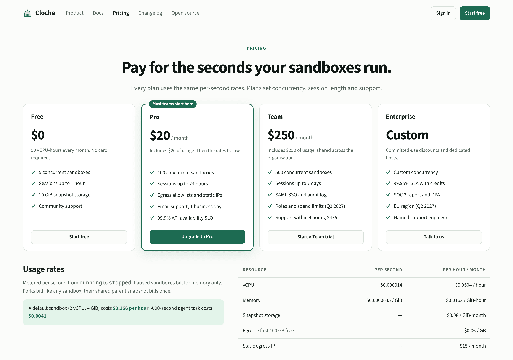
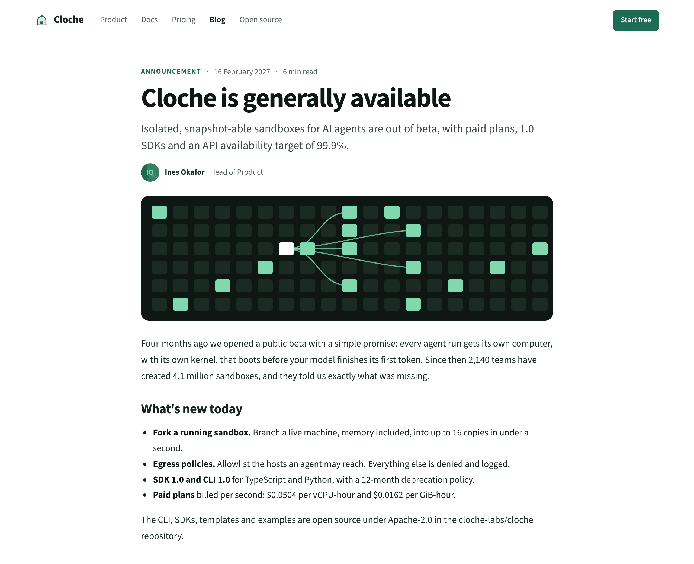
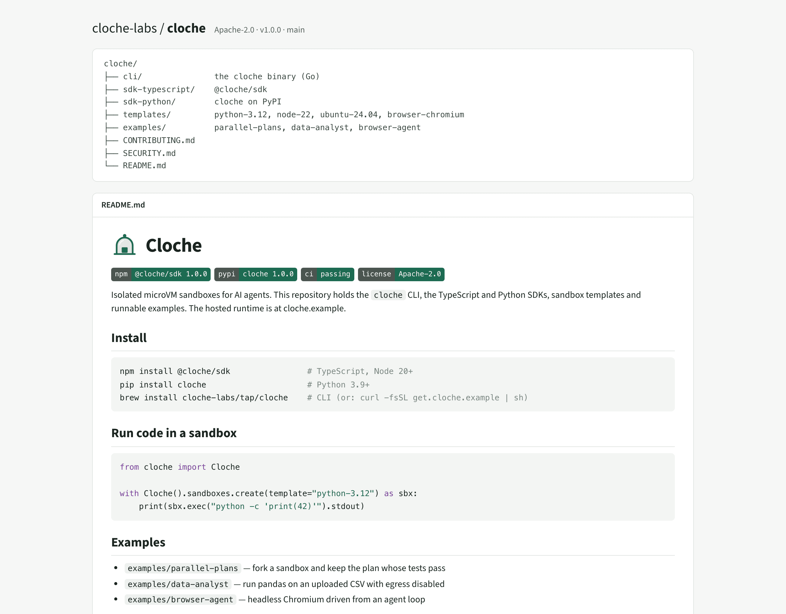
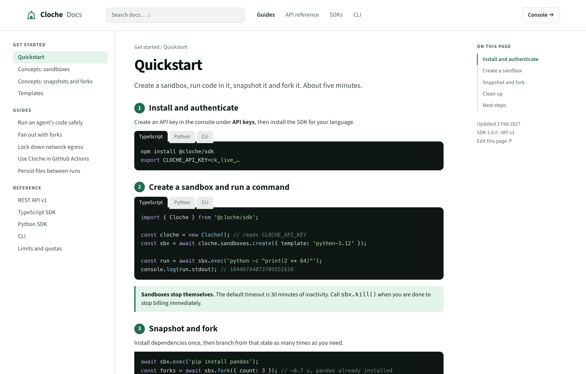
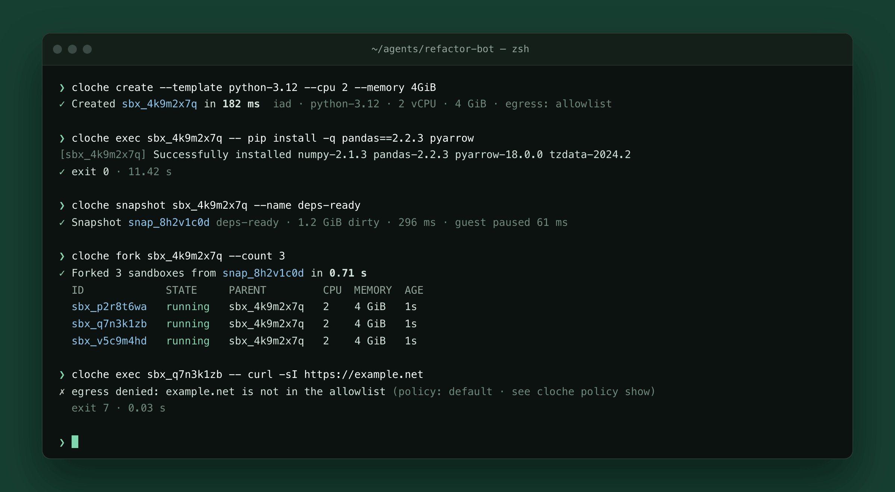
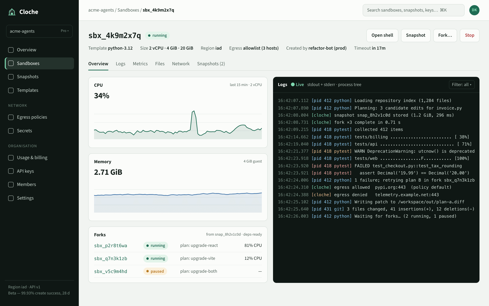
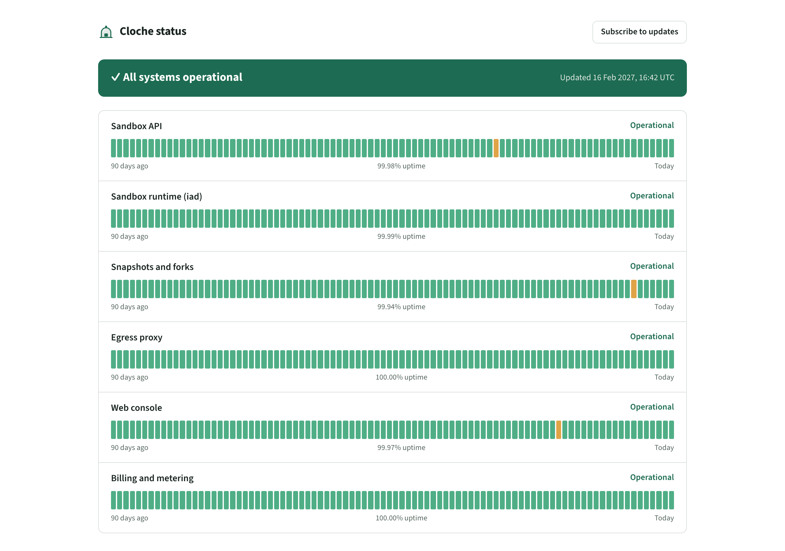
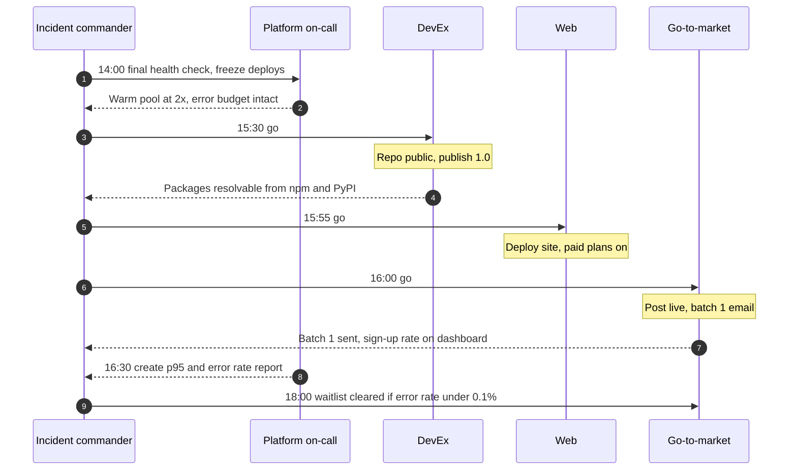

export const launchDay = 'Tuesday 16 February 2027';
export const waitlist = 11800;

## Goal

Move Cloche from public beta to a paid, supported product on {launchDay}, and convert the {waitlist.toLocaleString('en-US')} waitlisted teams plus new traffic into 1,500 paying organisations within 30 days.

<Outcome title="Launch success metrics, measured at T+30 days">
  1,500 paying organisations (Pro and above). 25,000 new sign-ups. Create success at or above 99.95%. No Sev-1 incident in launch week. Support first response within 4 hours for 95% of tickets.
</Outcome>

## What goes live

All of these surfaces switch at T-0. Select any screenshot to page through them.

## Timeline to launch

| Date | Milestone | Owner |
| --- | --- | --- |
| 11 Dec 2026 | Beta feature freeze; API v1 frozen | Tomás Varga |
| 15 Jan 2027 | Pricing signed off | Ines Okafor |
| 29 Jan 2027 | SDK 1.0 release candidates; pen test report | Jonah Whitfield, Hana Novak |
| 2 Feb 2027 | Launch rehearsal on staging, full run of show | Rafael Ortiz |
| 9 Feb 2027 | Go/no-go review 1; support rotation staffed | Ines Okafor |
| 12 Feb 2027 | Copy freeze for post, site and emails | Elena Petrova |
| 15 Feb 2027 | Go/no-go review 2, 17:00 UTC | Ines Okafor |
| 16 Feb 2027 | Launch, 16:00 UTC | Everyone |

## Launch-day sequence

## Run of show

| Time (UTC) | Action | Owner | Rollback |
| --- | --- | --- | --- |
| 14:00 | Deploy freeze; scale warm pool to 2x; final dashboards check | Rafael Ortiz | n/a |
| 15:00 | War room opens; go/no-go roll call | Ines Okafor | Postpone 24 h |
| 15:30 | Repository public; tag v1.0.0; npm and PyPI publish | Jonah Whitfield | Unpublish within 72 h, deprecate |
| 15:55 | Website deploy; paid plans on | Aiyana Brooks | Redeploy previous build, 3 min |
| 16:00 | Post live; social; waitlist email batch 1 of 5 | Elena Petrova | Pause remaining batches |
| 16:00 to 18:00 | Batches 2 to 5 every 30 min if create error rate under 0.1% | Sam Lindqvist | Hold batches |
| 16:30 | First health report in the war room | Rafael Ortiz | n/a |
| 20:00 | Day summary: sign-ups, paying orgs, incidents, top tickets | Ines Okafor | n/a |

## Go/no-go criteria

- [ ] Zero open critical or high pen test findings.
- [ ] Create success at or above 99.95% over the previous 7 days.
- [ ] Create p95 under 350 ms and fork p95 under 1.5 s over the previous 7 days.
- [ ] Billing reconciliation within 0.1% for the previous 14 nights.
- [ ] Rehearsal on 2 February completed with every rollback exercised once.
- [ ] Support rotation staffed for 7 days with named escalation engineers.
- [ ] Copy frozen and approved by Product, Marketing and Legal.

<Decision title="Waitlist release in batches">
  We release the 11,800 waitlisted teams in five batches over two hours instead of all at once. Beta launch day saw 1,900 sign-ups in the first hour and pushed create p95 to 2.1 s. Batching keeps the warm pool ahead of demand and gives us a lever if error rates rise.
</Decision>

<Risk title="Launch traffic exhausts the warm pool">
  If create p95 exceeds 1 s for 10 minutes, hold the remaining batches and add hosts. We have 60 spare hosts reserved for 72 hours from 14:00 on launch day, enough for 3x beta peak concurrency.
</Risk>

<Risk title="A competitor announcement the same week">
  Can't control it. The post leads with fork and egress policy, which we can demonstrate live, not with price.
</Risk>

## Prerequisites

<DependencyDiagram />
