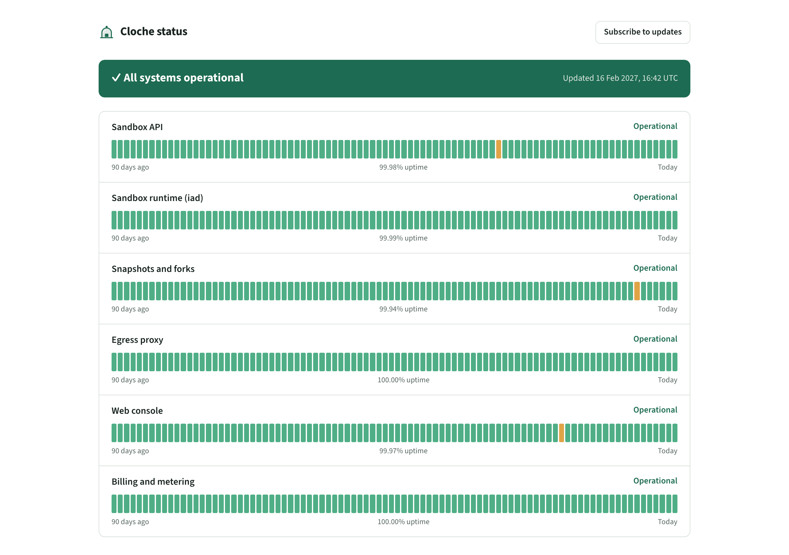

## Design

## SLOs at GA

| SLI | Objective | Window | Measured by |
| --- | --- | --- | --- |
| API availability (non-5xx, excluding 429) | 99.9% | 28 days | Load balancer logs |
| Create success | 99.95% | 28 days | Control plane |
| Create latency | p95 under 350 ms | 7 days | Control plane |
| Fork latency, 4 GiB | p95 under 1.5 s | 7 days | Control plane |
| Log delivery | p95 under 1 s | 7 days | Synthetic sandbox every minute |

Synthetic checks create, exec, snapshot and fork a sandbox every minute from two outside networks. Two consecutive failures open an incident automatically; the incident commander posts the first public update within 10 minutes.
