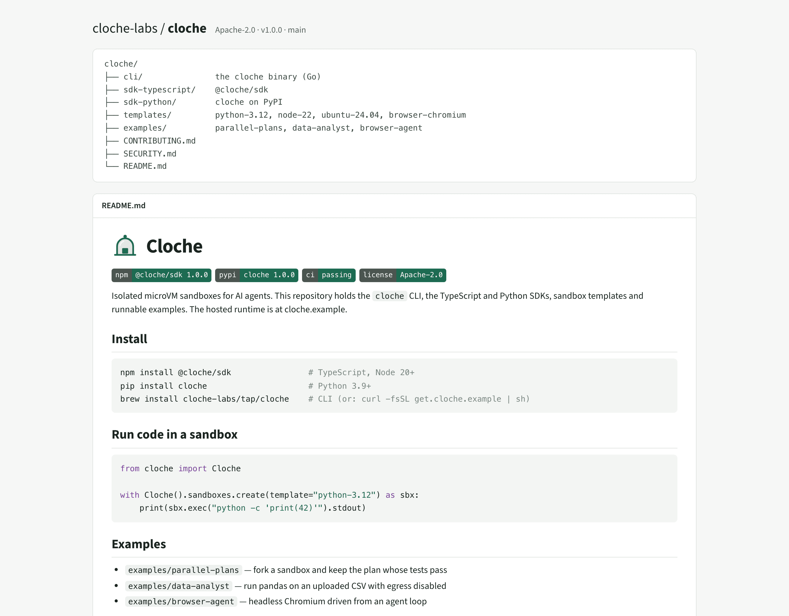

## README



The README answers four questions in this order: what is this, how do I install it, what is the smallest useful program, and what is open versus hosted.

## Layout

```text title="Repository layout"
cloche/
├── cli/                  Go, the cloche binary
├── sdk-typescript/       @cloche/sdk
├── sdk-python/           cloche on PyPI
├── templates/            template definitions (python-3.12, node-22, ubuntu-24.04, browser-chromium)
├── examples/
│   ├── parallel-plans/   fork and keep the plan whose tests pass (TS and Python)
│   ├── data-analyst/     pandas on an uploaded CSV with egress disabled
│   └── browser-agent/    headless Chromium driven from an agent loop
├── conformance/          SDK scenarios shared by both test suites
├── .github/workflows/    CI, release, CodeQL
├── CONTRIBUTING.md
├── SECURITY.md
└── LICENSE               Apache-2.0
```

## Contribution guide, in short

- Issues and pull requests are welcome for the CLI, SDKs, templates and examples. The hosted runtime is not in this repository.
- Every pull request runs unit tests and the conformance suite against a recorded API; maintainers trigger the live suite.
- We commit to a first response on issues within 3 business days.
- Security reports go to the private advisory flow described in `SECURITY.md`, never to public issues.

## Releases

Tags `v1.2.3` build the CLI for five platforms, publish both SDKs with provenance, and attach Sigstore signatures and an SBOM. Release notes come from conventional commit titles and are copied to the [public changelog](../../launch-ops/items/changelog.md).

## Go-public checklist

- [x] History rewritten from a clean import; internal hostnames and test keys scanned for (0 findings with two scanners).
- [x] Apache-2.0 headers and `LICENSE`; dependency licences reviewed.
- [ ] Branch protection, required reviews and signed tags on `main`.
- [ ] Issue and PR templates, labels and a `good first issue` set of 10.
- [ ] Three examples run end to end in CI against production.
- [ ] Visibility flipped at 15:30 UTC on 16 February by Jonah, with Hana on call.

<Risk title="A leaked secret in history">
  A credential in history would be public in minutes. We imported into a fresh repository instead of opening the existing one, and secret scanning blocks pushes. Any finding after go-public is treated as a Sev-1 with key rotation first, cleanup second.
</Risk>
