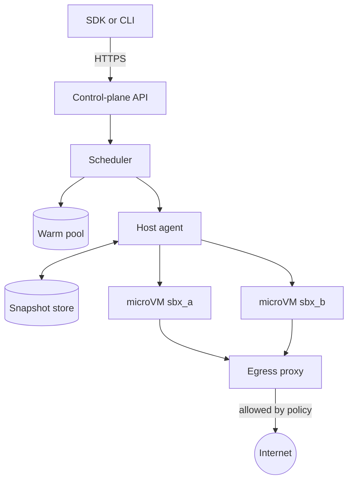

## What the runtime promises

Every sandbox is its own microVM with its own kernel. Nothing is shared between tenants except the host hardware and the hypervisor. On top of that isolation we offer four primitives: **create**, **exec**, **snapshot** and **fork**.

| Default | Value |
| --- | --- |
| vCPU / memory / disk | 2 vCPU, 4 GiB, 20 GiB |
| Maximum per sandbox | 16 vCPU, 32 GiB, 200 GiB |
| Cold start from warm pool | p50 182 ms, p95 420 ms (GA goal: p95 350 ms) |
| Snapshot create (4 GiB, dirty pages only) | p50 296 ms |
| Snapshot restore | p50 240 ms |
| Fork of a running sandbox | p50 710 ms, p95 1.9 s (beta exit goal: p95 1.5 s) |

## Architecture

The scheduler prefers a host that already holds the base snapshot in local NVMe. That locality is what keeps fork and restore under a second.
