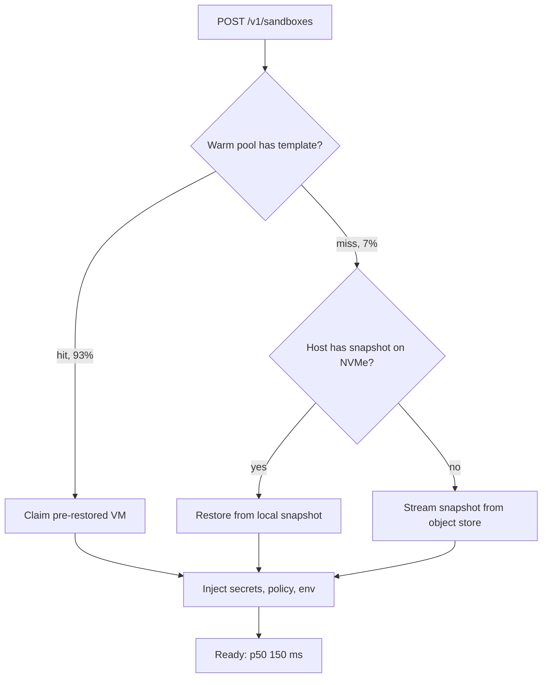

## Where we are

| Percentile | Alpha (Aug) | Beta (24 Nov) | GA goal |
| --- | --- | --- | --- |
| p50 | 210 ms | 182 ms | 160 ms |
| p95 | 640 ms | 420 ms | 350 ms |
| p99 | 2.4 s | 1.3 s | 800 ms |

Measured from the API receiving `POST /v1/sandboxes` to the guest agent reporting ready, for the three default templates, over all beta traffic.

## Where the tail comes from

The 7% of misses produce almost all of p95 and p99. Custom templates are 31% of creates but 80% of misses.

## Plan

1. Size the pool per template from the last 7 days of demand, refreshed every minute, instead of a fixed count of 40 per template.
2. Keep custom templates warm when they were created more than 50 times in the last hour.
3. Pre-fetch snapshot pages in working-set order (recorded at first restore) instead of on fault.

<Outcome title="Cost of the warm pool">
  The pool holds about 3% of fleet capacity idle. At GA volumes that is roughly $14,000 per month of hosts we do not bill for. Step 1 is expected to cut that by a third while improving hit rate.
</Outcome>
