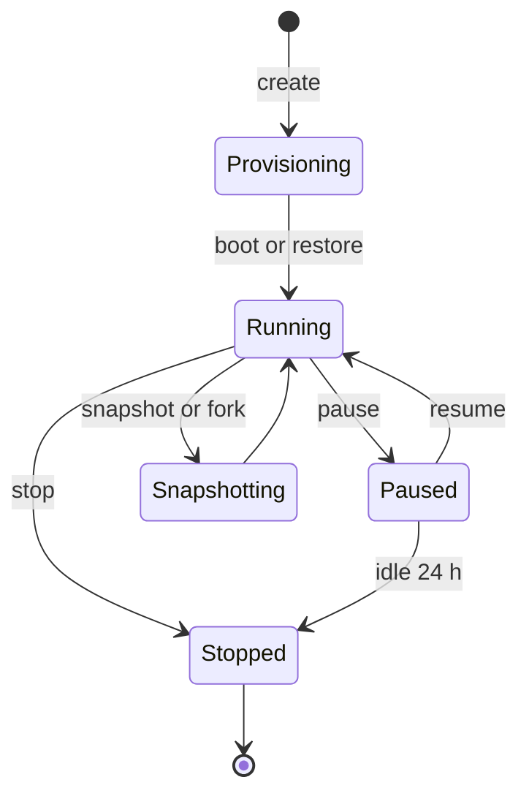
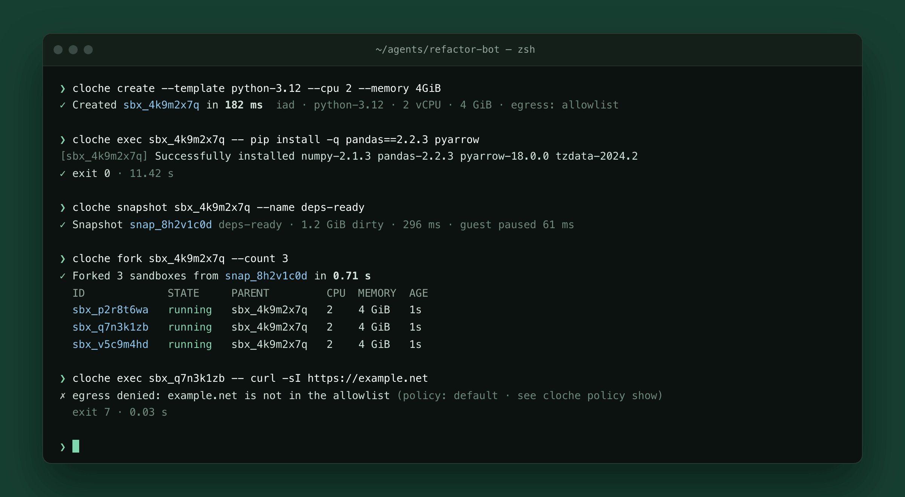

## Why

Twenty-nine of our 41 alpha design partners asked for the same thing: let an agent reach a good state (dependencies installed, repository cloned, a dev server warmed up), then try three or four plans from that state without paying for the setup again. Today they snapshot and restore by hand, which costs an extra API round-trip and loses running processes.

A fork keeps running processes, open files and memory. The copies are independent microVMs with their own network identity.

<Outcome title="Target">
  Fork a 4 GiB sandbox into 4 copies with p50 under 800 ms and p95 under 1.5 s, measured from the API request to all copies reporting `running`.
</Outcome>

## Lifecycle



A sandbox also reaches `Stopped` when its timeout expires. During `Snapshotting` the guest is paused for the time it takes to copy dirty pages, 40 ms to 120 ms for a 4 GiB guest. The new copies enter `Provisioning` from the stored snapshot and skip the boot entirely.

## Using it

From the CLI, a fork takes the source sandbox and a count:

```bash title="Terminal"
$ cloche fork sbx_4k9m2x7q --count 3
✓ Snapshot snap_8h2v1c0d (1.2 GiB dirty, 296 ms)
✓ Forked 3 sandboxes in 0.71 s
  ID             STATE     PARENT
  sbx_p2r8t6wa   running   sbx_4k9m2x7q
  sbx_q7n3k1zb   running   sbx_4k9m2x7q
  sbx_v5c9m4hd   running   sbx_4k9m2x7q
```



In the TypeScript SDK, `fork` returns ready sandboxes, so an agent can fan out and keep the best result:

```ts title="parallel-plans.ts"
import { Cloche } from '@cloche/sdk';

const cloche = new Cloche();
const base = await cloche.sandboxes.create({ template: 'node-22' });
await base.exec('git clone https://git.example/acme/shop && cd shop && npm ci');

const plans = ['upgrade-react', 'upgrade-vite', 'upgrade-both'];
const forks = await base.fork({ count: plans.length });

const results = await Promise.all(
  forks.map((sandbox, i) => sandbox.exec(`./agent-plan.sh ${plans[i]} && npm test`)),
);

const winner = results.findIndex((r) => r.exitCode === 0);
await Promise.all(forks.filter((_, i) => i !== winner).map((s) => s.kill()));
```

The Python SDK mirrors it. Forks are context managers, so losing branches are cleaned up:

```python title="parallel_plans.py"
from cloche import Cloche

client = Cloche()
base = client.sandboxes.create(template="python-3.12")
base.exec("pip install -r requirements.txt")

with base.fork(count=3) as forks:
    runs = [sbx.exec(f"python solve.py --strategy {s}") for sbx, s in zip(forks, ["greedy", "beam", "mcts"])]
    best = min(runs, key=lambda r: r.duration_ms if r.exit_code == 0 else float("inf"))
    best.sandbox.keep()  # every other fork is stopped when the block exits
```

## Billing

A fork is billed like any other sandbox from the moment it reaches `running`. Snapshot storage for the shared parent snapshot is billed once, not per fork. See [pricing plans](../../billing/items/pricing-plans.mdx).

<Decision title="Network identity of a fork">
  Each fork gets a new private IP and a new outbound NAT address. We considered keeping the parent's address so that allowlisted third parties keep working, but two machines with one address breaks TCP state. Agents that need a stable address use egress through a [static IP](./egress-policy.mdx#static-egress) instead.
</Decision>

<Risk title="Host memory pressure">
  Fan-out of 16 copies from a 32 GiB parent needs 512 GiB of guest memory in seconds. Copies share pages copy-on-write until they write, but a burst of writes can force the scheduler to place forks on other hosts, which adds a cross-host snapshot transfer of 1 s to 3 s. We cap `count` at 16 for beta and alert when more than 5% of forks land cross-host.
</Risk>

## Acceptance criteria

- [x] `POST /v1/sandboxes/:id/fork` with `count` 1 to 16, returning all child IDs.
- [x] Children inherit environment variables, files and running processes.
- [x] Children get fresh network identity and secrets are re-injected, not copied from memory.
- [ ] p95 under 1.5 s for a 4 GiB parent with 4 children (currently 1.9 s, cross-host placements are the tail).
- [ ] `fork` in both SDKs with the same semantics and docs.
- [ ] Console shows the parent and its children on the sandbox detail page.

## Open questions

- Should a fork be allowed from a `Paused` sandbox without resuming it first? It is cheaper but surprises people whose clocks jump.
- Do we expose the intermediate snapshot ID, or keep it internal and garbage-collect it with the last child?
