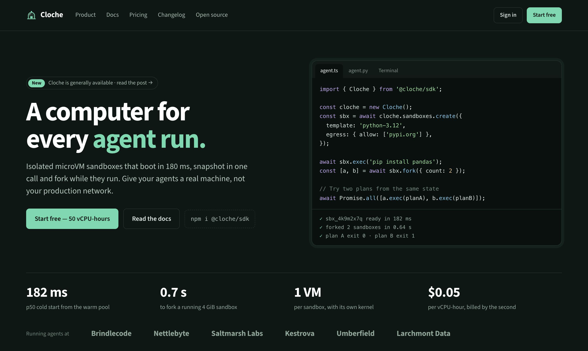

## Hero

Every number in the hero is a measured beta number, and each links to how we measured it:

| Claim on the page | Source | Refresh |
| --- | --- | --- |
| 182 ms p50 cold start | [Cold start work](../../runtime/items/cold-start.mdx) | Weekly, from production |
| 0.7 s to fork a running 4 GiB sandbox | [Fork](../../runtime/items/fork.mdx) p50 | Weekly |
| 1 VM per sandbox | [Isolation design](../../runtime/items/microvm-isolation.md) | Static |
| $0.05 per vCPU-hour | [Pricing plans](../../billing/items/pricing-plans.mdx) | On price change |

<Decision title="Code before diagrams">
  The hero shows code, not an architecture diagram. In five user interviews with agent developers, all five scrolled straight to the first code sample on competitor-style pages, and three said a diagram "looks like every other infra site".
</Decision>

## Performance budget

- LCP under 1.0 s on a Moto G Power over 4G (lab), under 1.8 s at p75 (field).
- Total JavaScript under 60 kB gzip; the code tabs work without JavaScript.
- No third-party scripts other than our own analytics endpoint.

## Experiment

Two headlines run 50/50 from 18 January on the waitlist page to pick the launch version: "A computer for every agent run" and "Sandboxes that fork". Primary metric: sign-up rate. Minimum sample: 9,000 visitors per arm to detect a 0.6-point difference.

<Risk title="Customer logos">
  The logo strip needs written permission. We have 4 of 6; the strip ships with whatever we have on 5 February and never with unapproved names.
</Risk>
