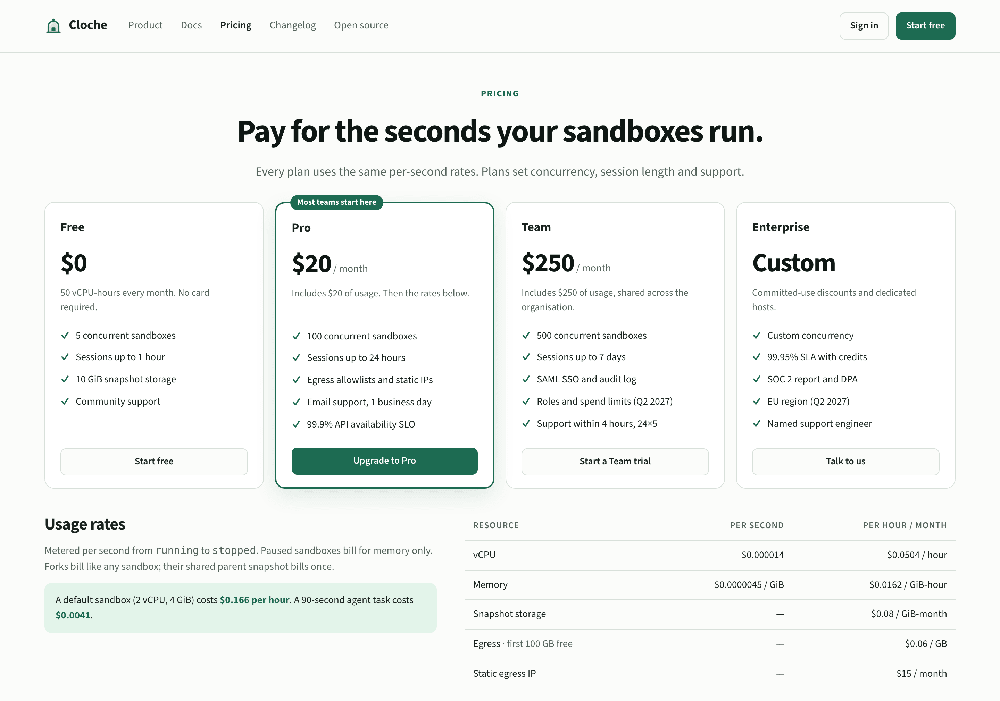

## Draft

## Still to decide

- Whether to show an interactive calculator at launch or a worked example only. The draft uses a worked example: a default sandbox at $0.166 per hour and a 90-second task at $0.0041.
- FAQ wording for "what happens when I hit the concurrency limit?" It must match the `429` behaviour in the [API](../../sdks/items/public-api.mdx).
