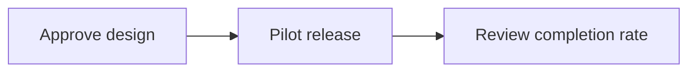

# Author a roadmap

Start with `roadmark init`. Set the title and optional Jira address in `roadmap.yaml`. Edit the two directory files beside it. Stable IDs keep assignments and profile URLs intact when a person or team changes name.

## Define people and teams

In `teams.yaml`, each key maps to a display name or to a record with a name and description.

```yaml
growth:
  name: Growth Engineering
  description: Owns workspace activation and onboarding.
analytics: Product Analytics
```

In `people.yaml`, a person may have a role and belong to several teams. Each member of `teams` must exist in the team directory.

```yaml
maya:
  name: Maya Chen
  avatar: avatars/maya.png
  role: Product Manager
  teams: [growth]
noor: Noor Patel
```

Set `avatar` to a workspace-relative PNG, JPEG, or WebP file. The build centers and crops the image into a small square thumbnail for the static site. The original can be any aspect ratio. Use the same person record under `people` in `roadmap.yaml` if your registry lives there.

Owner and contributor links, rosters, and the workspace directory use circular avatars. Hover or keyboard-focus an avatar to read the full name, or open it to see the person's profile. Search also matches the full name. Without a photo, Maya Chen appears as **MC** and Ana María López as **AML**. A single name uses its first two characters when available.

The site creates a profile for every directory entry, including entries with no assignments. A team profile shows its members, owned feature sets, and items it owns or contributes to. A person profile shows the sets they own and each item on which they are the effective PM or a named contributor. Each item links to its release when assigned. Team membership builds the roster. Personal assignments come from the work itself.

Open a product area from **Feature sets**, or select a person or team in an item’s planning details to see their assigned work. Use **Status**, **Release**, or **Feature set** to narrow it. On a person or team, **Involvement** also lets you isolate a role, such as owner or contributor. Each item appears once even when several roles apply. The roster and overall progress describe the full scope.

People and teams also have a dedicated timeline. Switch between the profile and its timeline to keep the active item filters. Copy the address to share the same selection, or use **Clear filters** to return to all work for that person or team. For example, `teams/platform/?role=contributing-team` shows the items Platform contributes to, and `teams/platform/timeline/?role=contributing-team` plots the same work. The static pages include the scoped records even when JavaScript is disabled.

The original inline `people` and `teams` mappings in `roadmap.yaml` still work. Move one registry at a time and remove its inline key in the same change. An explicitly empty directory is `{}`. Use `roadmark schema people` and `roadmark schema teams` for editor schemas.

## Write the brief

Create `feature-sets/<folder>/README.md` for the product area and `feature-sets/<folder>/items/<filename>.md` for each deliverable. Put the intended outcome in frontmatter. Use the body for context a reader will need, such as acceptance criteria, customer evidence, rollout details or risks. Folder membership determines the feature set. Its PM and engineering team apply to each item unless overridden there.

Use relative Markdown links between briefs and headings, as in the [fork example](../apps/cli/templates/ai-sandbox/feature-sets/runtime/items/fork.mdx). The compiler turns these into links to the published records. Changing a filename or moving an item retains its public URL as long as its `id` stays the same. Update relative source links when moving files.

## Link to project resources

Add an optional `links` list to a feature set’s README or an item’s Markdown or MDX frontmatter. Each entry has a label and an absolute HTTP or HTTPS URL. Paste the web address you would share with a teammate, including any query string or heading fragment.

```yaml
links:
  - label: Implementation repository
    url: https://github.com/example/onboarding
  - label: Onboarding design brief
    url: https://example.atlassian.net/wiki/spaces/PROD/pages/12345
  - label: Release board
    url: https://example.atlassian.net/jira/software/projects/ONB/boards/7
  - label: '#onboarding on Slack'
    url: https://app.slack.com/client/T01234567/C01234567
  - label: Accessibility reference
    url: https://www.w3.org/WAI/tutorials/forms/
```

Each page displays its own links in authored order. Beside each label, the reader’s browser loads the site icon from Google using the destination hostname. IP addresses and local names such as `wiki.internal` use a built-in globe. The globe also appears if the icon cannot load. Search for a link’s label, domain, or URL to find the brief that lists it. Keep using `jira: [ONB-142]` on an item for issue keys on your configured Jira instance. Use `links` for a board, a ticket on another instance, or any other website. Lint checks the address format locally. Readers use their usual access to open private destinations.

## Schedule work

Write releases under `releases/`. An item has zero or one release. To move an item, edit its `release` field. Release pages derive their entire scope from these assignments.

Milestones and team requests are no longer part of the format. `roadmark lint` fails a workspace that still has a `milestones/` folder or a `milestone`, `completed_on` or `team_dependencies` field and says what to delete. Put the dates you still need in release or item targets, and list collaborating teams in `contributing_teams`.

A release target such as `"2027-Q3"` means the quarter. An exact target such as `"2027-08-16"` means that day. Start dates always have day precision. Quote dates in frontmatter to keep their meaning clear across editors. An item with neither a start date nor a target is still part of its assigned release. When shipping a release, set `status: shipped` and `shipped_on` to the actual day. Retain its target so readers can see what changed.

## Coordinate across teams

Add individual collaborators to an item with `contributors: [noor]`. Use the owning engineering team for accountability and `contributing_teams` for collaborators. Use `depends_on` when another roadmap item supplies a prerequisite. Add a `reason` so readers understand what finishing that work unlocks. Jira keys can occur on multiple items.

## Include media

Store screenshots, GIFs, videos and captions alongside the relevant feature set, such as `feature-sets/onboarding/media/`. Include a screenshot or GIF with ordinary image syntax and descriptive alt text. A GIF gets a static first-frame poster and a playback control. Put a link to a local MP4 or WebM in its own paragraph. Readers can select the link text to expand a video player with captions and a download link. Link to the same video inside a sentence for a regular link. Place captions alongside the video using its stem and language, for example `setup-walkthrough.en.vtt`. Use ordinary HTTPS links for external resources.

## Write an MDX brief

Use `.mdx` for an item, release, or feature-set `README.mdx`. Keep the same YAML frontmatter and choose one README per feature set. Create a new item with `roadmark new item item-pilot --set onboarding --format mdx`. Plain Markdown remains the default.

MDX expressions, exports and components render during lint, build and dev. Build MDX from trusted authors because its modules execute with the Node process's permissions. The published pages contain the rendered HTML. Components that depend on client hydration or browser-only APIs need a static rendering alternative.

A product decision can include calculated values and a shared component. A source-relative import can point to a local JSX/TSX module or a reusable MDX partial. Put shared components outside the document collections, for example under `components/`. A partial's media and code include paths resolve relative to the containing brief.

```mdx
import PilotChecklist from '../../../components/pilot-checklist.tsx';

export const cohorts = 3;

<Decision title="Rollout decision">
  Start with {cohorts} pilot cohorts. Expand when the support team signs off.
</Decision>

<PilotChecklist />

<Outcome>Administrators complete setup within a day.</Outcome>

<Risk title="Incomplete telemetry">Verify the event contract before rollout.</Risk>
```

### Include code

Use a language fence for syntax highlighting. Give it a title for a visible filename. To display a file from the workspace, set `src` on an empty fence or use the MDX `Code` component. Paths are relative to the document. Saving the source file triggers a rebuild in dev. Unknown languages display as plain text.

````markdown
```ts title="rollout.ts"
const ready = signoffs.every((review) => review.approved);
```

```json src="../snippets/starter.json" title="starter.json"

```
````

```mdx
<Code src="../snippets/starter.json" lang="json" title="starter.json" />
```

### Draw diagrams

A `mermaid` fence in either format produces a local SVG. A title gives the diagram a caption and accessible name. Flowcharts suit decision points, sequence diagrams suit team handoffs, and Gantt charts suit authored rollout schedules. The roadmap timeline continues to read release and item dates from frontmatter. The compiler pins Mermaid 13.0.0-alpha.2 for its server-side renderer. Building a diagram requires neither Chromium nor a CDN.

````markdown

````

Use `<Mermaid src="../diagrams/rollout.mmd" title="Pilot rollout" />` in MDX for an external definition. For a diagram of the _actual_ prerequisites and dependents of an item, use `<DependencyDiagram />` or an empty `roadmap-dependencies` fence. Its links and explanations come from the same `depends_on` entries used by the linter.

### Open an image gallery

Select a still image or a rendered Mermaid diagram in an item to enlarge it. Select a standalone GIF to play it in place, then select it again to return to its poster. The lightbox uses the item's document order. Choose **Previous image** or **Next image**, or use the left and right arrow keys. **Escape** closes it and returns focus to the opener. An animated GIF counts as one image and starts on its still poster. With JavaScript disabled, standalone images and diagrams link directly to their full-size files.

The [usage metering item](../apps/cli/templates/ai-sandbox/feature-sets/billing/items/usage-metering.mdx) combines MDX callouts, highlighted code and a Mermaid diagram.

## Review the change

Run `roadmark lint --strict`, then open the release, team and timeline pages in `roadmark dev`. A release reports finished items against all its non-cancelled items. That count tracks scope delivered. Review the stated outcome separately, using the evidence in the brief. On the timeline, an exact target without a start is a marker, a broad target is a window, and a work interval is a bar.

The [field reference](reference.md) lists required fields and accepted values. The [ai-sandbox example](../apps/cli/templates/ai-sandbox) contains complete examples that are compiled and checked by the test suite.

## Find work in the published site

Press `/` to focus search. Enter a title, item ID, Jira key, outcome, or phrase from a brief. Use the arrow keys to select a result, Enter to open it, and Escape to return to the page.

For a team handoff, open Search, expand Filters, choose **Item** as the type, a status, and the team. Copy the address to share that view. A colleague opening it gets the same filters and search results.

On the timeline, select a bar or marker to see the work, dates and related prerequisites. Switch between months and quarters, or group the chart by release, feature set or engineering team. The list view includes the same work and dependency links and opens by default on small screens.
