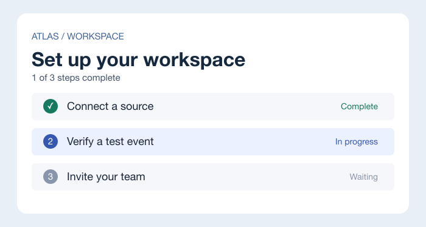

## Experience

Returning administrators pick up where they left off. The checklist uses the [setup event contract](../../platform/items/setup-events.md#event-contract).



[Watch the guided setup walkthrough](../media/setup-walkthrough.mp4)

## Acceptance criteria

- [x] Preserve completed steps when the administrator returns.
- [ ] Explain how to retry a failed connection.
- [ ] Distinguish first-time setup from a retry.

## Delivery sequence

```roadmap-dependencies
```
