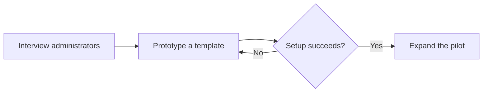
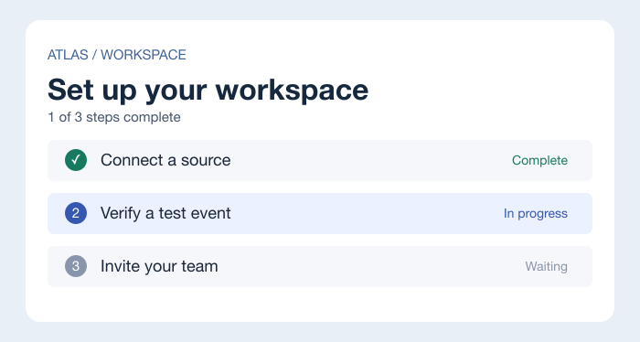
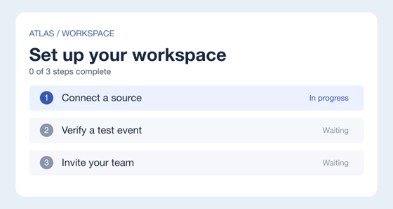

## Discovery

Interview administrators about the steps they repeat across workspaces.

export const interviewCount = 6

<Decision title="Pilot audience">
  Interview {interviewCount} workspace administrators before selecting the first template.
</Decision>

## Pilot sequence

## Example template

<Code src="../snippets/starter.json" lang="json" title="starter.json" />

## Design references

